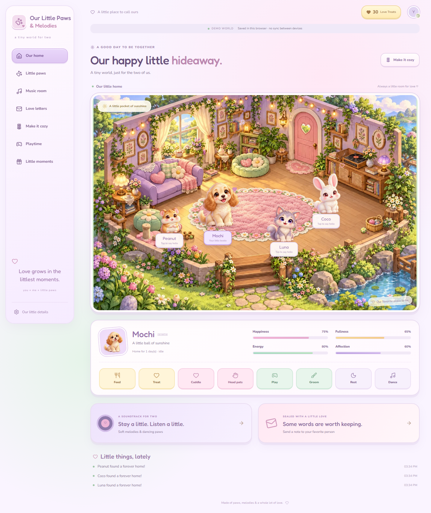
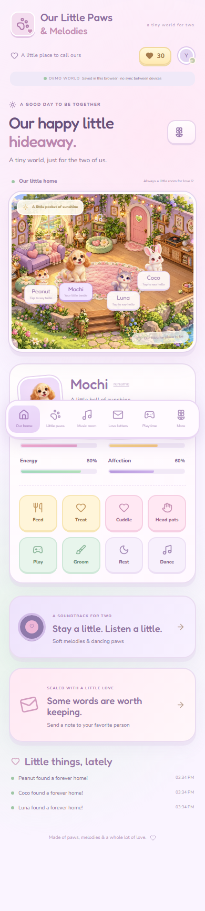
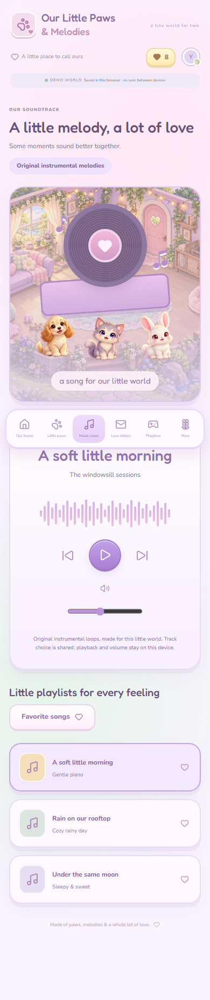

# Our Little Paws & Melodies

**A tiny world, just for the two of us.** An illustrated, private virtual pet home for a couple, built with React, TypeScript, Vite, Tailwind CSS, Motion, Lucide, React Router, TanStack Query, Zustand, Zod, React Hook Form, and Supabase.



<p></p>

## What works

- Animated welcome and four original illustrated pets: Mochi the puppy, Luna the kitten, Coco the bunny, and Peanut the hamster. Adopt, select, rename, and care for each pet.
- Feed, treat, cuddle, head pats, play, groom, sleep/wake, and dance; bounded needs, cooldowns, adoption age, animation feedback, and activity history.
- A responsive illustrated home; wallpapers, rugs, beds, and shared accessories purchased using non-purchasable Love Treats.
- Music room with three original synthesized instrumental loops, playlist selection, favorites, volume/play controls, and dancing animals. Shared mode shares track selection and favorites. Playback controls remain device-local.
- Private letters with recipients, three envelope styles, read state, favorites, filters, and accessible compose/open dialogs.
- Catch the Treats (touch/mouse slider, arrow keys, and an accessible catch button) and Musical Notes (visual sequence, no audio needed). Start, pause, finish, scoring, and bounded participation gifts.
- Six achievements, a wrapped affectionate surprise, and protected household name/greeting settings.
- Browser-local demo persistence; authenticated shared mode through PostgreSQL RPCs, RLS, and Realtime query invalidation.
- Offline indicator, production static-asset service worker, reduced motion, keyboard controls, focus indicators, and phone navigation to every room.

## Local development

Use **Node.js 24 LTS** and npm. No credentials are needed to try the demo.

```sh
npm ci
npm run dev
```

Open the URL printed by Vite (normally `http://localhost:5173`). Choose **Enter Our Little World**, then adopt your first friend. The home starts empty intentionally; all four pets can be adopted for free.

```sh
npm run lint
npm run typecheck
npm test
npm run test:db
npx playwright install chromium
npm run test:e2e
npm run build
npm run preview
```

`npm run test:e2e` starts its own server on port 5190. `npm run format` formats application and test code. `scripts/screenshots.mjs` starts its own isolated demo server on port 5195 and captures desktop/mobile previews without using your shared household.

## Demo mode

When either Supabase public environment variable is missing, the app visibly labels itself **DEMO WORLD — saved in this browser, no sync between devices**. The world, demo letters, and idempotency receipts live in `localStorage`. Both demo identities are fictional labels, and letters can be addressed to either. They do not send email or reach another device. Do not put sensitive real letters into a demo on a shared browser. Clear the `little-paws-*` storage keys to reset it.

Demo rules are illustrative and browser-editable. Production rewards and permissions are enforced independently by PostgreSQL. There are no payments, ads, streaks, punitive decay, pet death, or permanent loss. Pet needs do not decay during inactivity; rest gives a fixed, bounded energy increase using a server timestamp and cooldown.

## Supabase setup

1. Create a Supabase project. In **Authentication → Providers → Email**, disable new user signups. Also disable anonymous sign-in. Public account or household creation is deliberately absent from this app.
2. In **Authentication → URL Configuration**, set your production site URL. With the email/password sign-in flow used here, invite users and establish their passwords through Supabase's trusted admin flow before they sign in. Configure and test your project's invitation/password setup process; this app has no public signup or password-reset screen.
3. Apply `supabase/migrations/202610270001_world.sql` once in the SQL editor as project owner. Alternatively use the Supabase CLI:

   ```sh
   supabase login
   supabase link --project-ref YOUR_PROJECT_REF
   supabase db push
   ```

4. Invite exactly two accounts using Supabase's administrator interface. Copy their **Auth user UUIDs**. Edit `supabase/bootstrap.sql`, set `first_user` to your Auth UUID, optionally set `second_user` to your partner’s quoted UUID, and choose display names. Run it as administrator. You may leave `second_user` as NULL to test one account first, then rerun with the same `first_user` to add your partner. The script preserves existing profiles and memberships, reuses their household, and provisions ordered songs atomically. Never run the unedited first-user placeholder. A membership trigger enforces a maximum of two people; each account belongs to one household.
5. Copy `.env.example` to `.env.local`. Fill only the project URL and its **publishable/public key**. Do not paste a service-role or secret key. Use `/` for `VITE_BASE_PATH` during development.
6. Restart Vite. Sign in as each invited account on separate browsers/devices. Adopt a pet, cuddle it, send a letter, change a decoration, and verify the other session updates.

### RLS, RPCs, and private storage

The migration enables RLS on every application table. Authenticated users have scoped SELECT access. They receive **no direct table write grants**; authoritative changes use `world_action(p_command jsonb, p_key uuid)`. `get_world()` returns only the authorized household and letters where the caller is sender or recipient, including self-addressed letter privacy.

`world_action` checks `auth.uid()` and membership, uses a hardened empty `search_path`, locks the household before reading balances, checks idempotency, validates known action names, and performs writes atomically. Pet care has a 1.5-second cooldown; only the first 30 care actions per UTC calendar day earn 2 treats. Games grant a fixed 3 treats per household, at most once per minute and ten times per UTC day. Client scores and reward amounts never determine currency. A household limit of 60 mutations per rolling minute also applies. Duplicate successful idempotency keys return current state without repeating side effects.

The `household-audio` bucket is private. A read policy accepts only paths beginning with the caller's household UUID. Uploads remain administrator-only. The current player uses bundled public original instrumentals; it does not request private Storage audio objects. Supabase project administrators remain trusted and can access project data; letters are access-controlled, not end-to-end encrypted.

### Realtime

The migration adds `activity_events` to `supabase_realtime`. Verify that replication is enabled for this table in the dashboard. Every successful mutation adds a generic, household-scoped activity event, never letter contents. The client subscribes with a household filter; events invalidate the world query. Query reconnect/window-focus refresh and Supabase session refresh provide recovery paths. Event notices deliberately contain no location or session metadata.

If the table is already in your publication, omit only the duplicate `ALTER PUBLICATION ... ADD TABLE` statement when applying manually. Keep publication changes in migrations for fresh environments.

### Database tests

`npm run test:db` uses **PGlite embedded PostgreSQL**, executes the actual migration (excluding only the pgcrypto extension declaration and Supabase publication registration), stubs Auth/Storage schemas, and tests RLS and functions. This is real PostgreSQL policy/function execution, but it does **not** exercise hosted Supabase Auth, Storage, Realtime, or network concurrency.

For full local Supabase testing, install the Supabase CLI and start Docker Desktop:

```sh
supabase start
supabase db reset
supabase test db
```

`supabase/tests/security.sql` includes pgTAP tests for authorization, cross-household isolation, private letters, fixed rewards, cooldowns, and duplicate requests. Hosted two-account testing is still required before launch.

## GitHub Pages deployment

The workflow `.github/workflows/pages.yml` verifies pull requests and verifies/deploys pushes to `main` or manual dispatch. It uses `npm ci`, ESLint, TypeScript, unit tests, a production build, Chromium desktop/mobile tests, official Pages artifact upload, and official Pages deployment. Only the deployment job gets `pages:write` and `id-token:write`.

1. Push this repository and its lockfile to GitHub.
2. In **Settings → Pages → Build and deployment**, choose **GitHub Actions**.
3. In **Settings → Secrets and variables → Actions → Variables**, set `VITE_SUPABASE_URL` and `VITE_SUPABASE_PUBLISHABLE_KEY` for shared mode. Omitting them intentionally deploys the labeled demo.
4. Push to `main` or run the workflow manually.
5. Open `https://YOUR_OWNER.github.io/YOUR_REPOSITORY/`.

The workflow derives `VITE_BASE_PATH=/${repository-name}/`. For a user/organization root Pages site or custom domain at `/`, change it to `/`. Hash routes keep direct navigation working without server rewrites. Vite's public base also scopes the service worker. No `.env` files are included in the build. Public `VITE_*` values are embedded in JavaScript by design; **never** use them for secrets. Deployment has been prepared, not performed from this workspace.

## Environment reference

| Variable                        | Purpose                                              |
| ------------------------------- | ---------------------------------------------------- |
| `VITE_SUPABASE_URL`             | Supabase project HTTPS URL                           |
| `VITE_SUPABASE_PUBLISHABLE_KEY` | Public/publishable browser key, protected by RLS     |
| `VITE_BASE_PATH`                | `/` locally, `/repository/` for a Pages project site |

## Project layout

```text
src/
  App.tsx                  Routing, auth, home, query/realtime lifecycle
  components/
    PetArt.tsx             Four original transparent character illustrations
    Room.tsx               Responsive illustrated room and placement
    Dialog.tsx             Focus containment, Escape, focus restoration
  features/*.tsx           Separate home, adoption, music, mail, decor, game, settings routes
  lib/
    model.ts               Types, catalog, species, pure care rules
    api.ts                 Typed demo/Supabase command adapters and validation
    ui.ts                  Ephemeral Zustand selection and notices
  styles.css               Base layout and accessible UI styles
  styles/game-theme.css    Pastel game tokens, dollhouse layout, character motion
  *.test.tsx / lib/*.test.ts Unit and component tests
supabase/
  migrations/              Schema, RLS, secure transactional RPCs, storage
  tests/security.sql       Local Supabase pgTAP policy tests
  bootstrap.sql            Administrator-only two-user provisioning example
  config.toml              Local Supabase configuration with signup disabled
scripts/                   Embedded database checks and screenshot capture
tests/                     Desktop and mobile Playwright journeys
public/art/                Original room and pets, optimized WebP, prompt provenance
public/sw.js               Static assets only; no private API response cache
docs/screenshots/          Actual application previews
.github/workflows/         Verification and Pages deployment
```

## Artwork, fonts, and audio

The isometric room and four fluffy character illustrations were generated specifically for this application with the built-in image-generation tool, inspired by the supplied cozy-game references. The artwork assets are local optimized WebP files under `public/art/`; character alpha transparency is preserved. The complete prompt set and asset provenance are recorded in `public/art/provenance.json`. No reference screenshots, stock photos, or remote illustration dependencies are embedded. Painted floral rugs and quilted pet beds use separate transparent assets, with a clean background so the selected items replace their original room counterparts. All layers use one normalized 1536 × 1024 scene to preserve placement across screen sizes. Decoration prompts are in `public/art/decorations-provenance.json`. Edit `PetArt.tsx` and `Room.tsx` for interaction overlays and predefined placement. Decorative bows, hats, and motion remain CSS/SVG; animations move the illustrated characters rather than rendering separate facial frames. Theme tokens and responsive game styling are in `src/styles/game-theme.css`; Fredoka and Nunito load from Google Fonts with local system fallbacks. For an entirely self-contained deployment, self-host their appropriately licensed font files and update `index.html`.

The music player uses three **original instrumental WAV loops**, generated without samples or external recordings by `scripts/generate-audio.mjs`. Regenerate them with `node scripts/generate-audio.mjs`. Audio starts only after pressing Play. Play/pause, previous/next, volume, loop playback, route-exit cleanup, and loading/playback errors are implemented with a native HTMLAudioElement. For other legally permitted recordings, extend the bundled catalog or implement signed private Storage URLs. Use official provider embeds for streaming services. Do not extract protected audio. Position synchronization, provider login, uploads, and arbitrary external track URLs are not implemented.

Track titles/order and favorites come from PostgreSQL in shared mode; demo mode has three bundled metadata entries. Changing the selection is shared, but play/pause and volume are local. Song administration and profile display-name changes are intentionally administrator tasks.

## Offline and privacy

The service worker runs only in a production build on HTTPS or localhost. It caches same-origin navigation and static JS/CSS/SVG/PNG/WebP/WOFF2 assets; it never caches Supabase API responses, private letters, or audio. Shared state is held in memory only. When a running session goes offline it keeps its last loaded state and rejects shared mutations. A fresh offline reload can show the cached visual shell, but has no persisted shared pet snapshot or letters. It cannot authenticate or fetch new data offline. Demo mode remains browser-local and usable offline after assets have been cached. No offline write queue or reconciliation is attempted.

## Validation and known limits

The implementation has passed lint, type checking, production compilation, 17 unit/component tests, 25 embedded PostgreSQL checks, and four desktop/mobile Playwright journeys covering care, mail, music, decorating, games, settings, and offline state. Actual 1440px desktop and 390px mobile renders were inspected. Docker was not running in the implementation environment, so full Supabase pgTAP and live two-account Realtime tests have not been run. Run those after provisioning your project.

This is an operational MVP. Accessories apply to all pets together, rather than per-pet equipment. Pet states persist until another interaction; no background simulation runs. The wrapped surprise message is editable in protected household settings; scheduled birthdays, custom gifts, and pet concerts are future enhancements. Letters share a favorite flag between their participants. Neither irreversible pet loss nor notification pressure is used. Long-lived database action/audit records currently have no scheduled retention job; configure retention as appropriate without deleting idempotency receipts still needed by retrying clients.

## Troubleshooting

- **Demo appears unexpectedly:** both Supabase variables must be populated before starting/building Vite. Pages variables are build-time configuration; redeploy after changing them.
- **Sign-in works but household fails to load:** confirm the profile and membership were provisioned for that exact Auth UUID. Do not relax RLS to work around provisioning errors.
- **One browser does not update:** check the `activity_events` publication, authenticated subscription, membership policies, and network connectivity. Refresh/reconnect to reload authoritative state.
- **Assets 404 on Pages:** confirm `VITE_BASE_PATH` matches the repository path, including leading/trailing `/`. Route URLs use `#/...`.
- **Old offline shell:** reload while online; if necessary unregister the service worker and clear the `little-paws-static-v3` cache. Do not clear demo local storage unless you want to reset it.
- **Tests cannot launch a browser:** run `npx playwright install chromium`; Linux CI uses `--with-deps`. Ensure port 5190 is available.
- **Full database tests fail to start:** launch Docker Desktop first. Embedded checks still run without Docker.
- **No music is audible:** press Play first, check device mute/output volume and the in-app slider, and verify `audio/morning.wav` loads under the configured base path. A visible error offers a retry if playback is blocked or the file cannot load.

## Production launch checklist

- [ ] Apply the migration and provision exactly two invited users.
- [ ] Disable public signups and anonymous auth; establish invited accounts' passwords securely.
- [ ] Confirm no service-role/secret key appears in browser configuration or Git history.
- [ ] Run pgTAP and the two-device shared-mode care, letter, decoration, and music checks.
- [ ] Check private letters, self-addressed letters, and cross-household denial using another test household.
- [ ] Confirm private Storage and Realtime publication/policies.
- [ ] Run all npm checks and verify desktop, phone, keyboard, reduced-motion, and offline flows.
- [ ] Configure Pages variables/settings and verify the deployed project base path.
- [ ] Verify the bundled original instrumental loops play on both devices; playback positions remain device-local.
- [ ] Configure backups, account recovery, and appropriate audit-data retention.

References used for integration decisions: [Vite getting started](https://vite.dev/guide/), [Supabase database functions](https://supabase.com/docs/guides/database/functions), and [Supabase row-level security](https://supabase.com/docs/guides/database/postgres/row-level-security).
